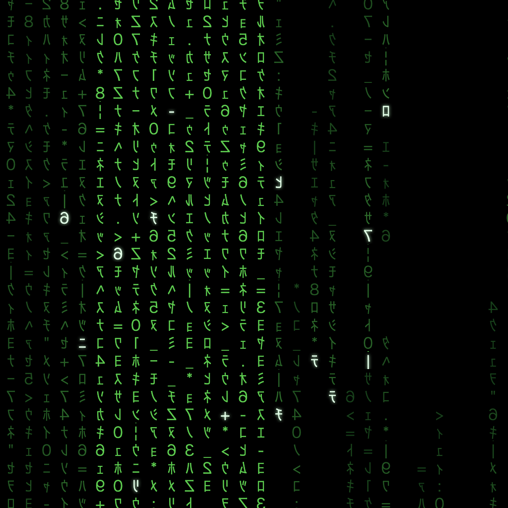

# Matrix Screensaver

A screensaver in the style of _The Matrix_: cascading glyph rain across every
display, with movie scenes rendered inside the rain as the brightness of its
own characters. One code base for macOS and Linux.



It is a standalone menu-bar / tray app rather than a `.saver` bundle or an
XScreenSaver hack. Apple's third-party screensaver engine is unreliable on
recent macOS (second displays stay black), so the app watches system idle time
itself and covers each display with a fullscreen window when the threshold
passes. Any key, click, scroll or mouse movement dismisses it.

**Contents**

- [Install](#install)
- [First run](#first-run)
- [Adding movie scenes](#adding-movie-scenes)
- [Configuration](#configuration)
- [Start at login](#start-at-login)
- [How it works](#how-it-works)
- [Running from source](#running-from-source)
- [Packaging and releasing](#packaging-and-releasing)
- [Troubleshooting](#troubleshooting)
- [Known limits](#known-limits)

## Install

Download the build for your machine from the
[releases page](https://github.com/pinhigh-ai/matrix-screensaver/releases).

### macOS (Apple silicon)

1. Open the `.dmg` and drag **Matrix Screensaver** to Applications.
2. The app is not signed or notarized, so the first launch has to be from
   Finder: right-click the app, choose **Open**, then **Open** again in the
   dialog. On macOS 26 the dialog may instead send you to
   System Settings > Privacy & Security, where an **Open Anyway** button
   appears for it.
3. Nothing visible opens. The app lives in the menu bar as a small icon of
   three dotted columns; there is no Dock icon and no window.

From the terminal, the same steps are:

```bash
gh release download v0.1.1 --repo pinhigh-ai/matrix-screensaver --pattern "*.dmg" --dir ~/Downloads
open ~/Downloads/Matrix.Screensaver-0.1.1-arm64.dmg
cp -R "/Volumes/Matrix Screensaver 0.1.1-arm64/Matrix Screensaver.app" /Applications/
```

### Fedora (and other Linux)

```bash
sudo dnf install ./matrix-screensaver-0.1.1-x86_64.rpm
```

or make the `.AppImage` executable and run it. The app runs under XWayland on
GNOME Wayland, which is what lets it place a window on every display. It needs
a font with half-width katakana for the glyphs:

```bash
sudo dnf install google-noto-sans-cjk-fonts
```

Launch it from the applications menu, or run `matrix-screensaver`. It appears
as a tray icon.

### Tell the system screensaver to stand down

The app triggers after `idleMinutes` of no input (5 by default). Set the
operating system's own screensaver, screen lock and blanking to a longer
timeout than that, or off, otherwise the two fight over the screen. Display
sleep is unaffected and still happens on the system's schedule.

- macOS: System Settings > Lock Screen, "Start Screen Saver when inactive" and
  "Turn display off" both longer than `idleMinutes`.
- GNOME: Settings > Power, "Screen Blank" longer than `idleMinutes`; Settings >
  Privacy > Screen Lock as you prefer.

## First run

Click the menu-bar / tray icon. The menu has:

| Item               | What it does                                                                     |
| ------------------ | -------------------------------------------------------------------------------- |
| **Preview now**    | Shows the saver on every display immediately. Move the mouse to dismiss it.      |
| **Start at login** | Installs or removes the autostart entry (see [Start at login](#start-at-login)). |
| **Clips folder**   | Shows where the app looks for movie clips. Not clickable; it is there to copy.   |
| **Quit**           | Stops the app. The saver will not trigger again until you launch it.             |

Without any clips the saver is rain only, which is a fine screensaver on its
own. The rest of this guide is about putting scenes inside it.

You can also show the saver from a terminal:

```bash
"/Applications/Matrix Screensaver.app/Contents/MacOS/Matrix Screensaver" --now   # macOS
matrix-screensaver --now                                                         # Linux
```

`--now` starts the app and shows the saver at once; afterwards it keeps running
in the tray as usual.

## Adding movie scenes

A scene is a short, silent, low-resolution video. Each frame is sampled down to
one brightness value per rain cell, so the picture is literally drawn with the
rain's glyphs. The app never ships footage; you prepare your own.

### Where clips live

The packaged app reads clips from a folder under your user data:

| OS    | Clips folder                                             |
| ----- | -------------------------------------------------------- |
| macOS | `~/Library/Application Support/matrix-screensaver/clips` |
| Linux | `~/.config/matrix-screensaver/clips`                     |

The folder holds the prepared `.webm` files and a `manifest.json` listing
them:

```json
{ "clips": [{ "file": "lobby.webm" }, { "file": "subway.webm" }] }
```

You can point the app somewhere else with `clipsDir` in the config file.

### Preparing clips from your own videos

The preparation script needs ffmpeg and Node, so it runs from a checkout of
this repository:

```bash
git clone https://github.com/pinhigh-ai/matrix-screensaver.git
cd matrix-screensaver
npm install
brew install ffmpeg            # macOS
sudo dnf install ffmpeg        # Fedora
```

Put any videos (phone recordings, screen captures, anything ffmpeg can read)
into `clips/raw/`, then prepare them straight into the app's clips folder:

```bash
CLIPS_DIR="$HOME/Library/Application Support/matrix-screensaver/clips" scripts/prepare-clips.sh   # macOS
CLIPS_DIR="$HOME/.config/matrix-screensaver/clips" scripts/prepare-clips.sh                       # Linux
```

Each input becomes a silent 384x216 WebM (a portrait video comes out 384 wide
and taller; the app crops it to the screen at display time) and the manifest is
rewritten to list every clip in the folder. You can also pass specific files
instead of processing the whole `clips/raw/` folder:

```bash
CLIPS_DIR="..." scripts/prepare-clips.sh ~/Downloads/dogs.MOV
```

To remove a clip, delete its `.webm` from the clips folder and either edit the
manifest or run `node scripts/write-manifest.mjs "<clips folder>"` to
regenerate it.

### Fetching scenes from YouTube

`scripts/fetch-clips.sh` downloads just the sections you want with
[yt-dlp](https://github.com/yt-dlp/yt-dlp) and then runs the prepare script.
You run it yourself: film footage is copyrighted and downloading it is against
YouTube's terms, so this repository only ships the tooling.

```bash
brew install yt-dlp            # macOS
sudo dnf install yt-dlp        # Fedora
cp clips/sources.example.txt clips/sources.txt
```

Edit `clips/sources.txt`. One scene per line: URL, start time (`m:ss` or
seconds), duration in seconds, and a name. The example lists the lobby, red
pill, dojo, subway and rooftop scenes with guessed offsets; check them against
the videos. Then:

```bash
CLIPS_DIR="$HOME/Library/Application Support/matrix-screensaver/clips" scripts/fetch-clips.sh
```

Downloads land in `clips/raw/` and are skipped on later runs unless you set
`FORCE=1`.

### Making the picture read well

Three settings in the [config file](#configuration) shape how a clip looks:

- **`sceneFit`** (default `cover`): crop the clip so it fills the screen.
  `contain` keeps the whole frame with black bars, which looks like a small
  window of code in the middle of the rain.
- **`sceneInvert`** (default `false`): film footage is usually bright faces on
  dark backgrounds, which is what the rain wants. A phone video of something
  dark on a bright floor or sky reads as a hole in the code; turn invert on
  and the subject becomes the bright part.
- **`sceneLoop`** (default `false`): off, the saver waits a random
  `sceneIntervalSeconds`, plays one clip (never the same one twice in a row),
  fades it out, and waits again. On, it starts the first clip within two
  seconds and loops it for as long as the saver is up, which suits a single
  favourite scene.

Every frame also gets auto-levels (its 3rd to 97th percentile stretched to
black and white) and a steep tone curve, so a textured floor stops filling
every cell and only the subject lights up. Those are fixed; the three settings
above are the knobs.

## Configuration

A JSON file, created by you, in the per-user data folder:

| OS    | Config file                                                    |
| ----- | -------------------------------------------------------------- |
| macOS | `~/Library/Application Support/matrix-screensaver/config.json` |
| Linux | `~/.config/matrix-screensaver/config.json`                     |

Every key is optional; anything missing or of the wrong type falls back to its
default, and a malformed file is ignored entirely. Restart the app (Quit, then
launch) after changing it.

| Key                    | Default     | Meaning                                                                    |
| ---------------------- | ----------- | -------------------------------------------------------------------------- |
| `idleMinutes`          | `5`         | Idle time before the saver starts                                          |
| `cellSize`             | `18`        | Glyph cell size in CSS pixels; smaller means denser rain and more GPU work |
| `sceneIntervalSeconds` | `[45, 120]` | Random wait between scenes, min and max (ignored when `sceneLoop` is on)   |
| `sceneFadeSeconds`     | `2`         | Fade in and fade out length for each scene                                 |
| `clipsDir`             | `""`        | Folder of prepared clips; empty means the default folder above             |
| `sceneFit`             | `"cover"`   | `cover` crops the clip to fill the screen; `contain` fits it with bars     |
| `sceneLoop`            | `false`     | Start a clip right away and loop it for as long as the saver is up         |
| `sceneInvert`          | `false`     | Swap dark and light, for a dark subject on a bright background             |

Example:

```json
{
  "idleMinutes": 10,
  "sceneLoop": true,
  "sceneInvert": false
}
```

## Start at login

Tick **Start at login** in the tray menu. On macOS it writes a LaunchAgent to
`~/Library/LaunchAgents/ai.pinhigh.matrix-screensaver.plist`; on Linux an XDG
autostart entry to `~/.config/autostart/matrix-screensaver.desktop`. Untick to
remove it. The item is disabled when running from source, because the
executable would be Electron itself.

## How it works

```
main process                     renderer (one per display)
------------                     --------------------------
idle watcher (powerMonitor)      rain simulation  -> cell grid (glyph, brightness)
  -> IdleMachine                 scene layer      -> clip frame -> luminance per cell
  -> one window per display                        -> auto-levels, tone curve, invert
tray menu, config, clip list     composite        -> rain dimmed by scene strength
dismiss on input (IPC)           glyph atlas draw -> one blit per lit cell, 60+ fps
```

- **Rain**: each column owns a few streams. A head falls at a constant speed,
  writing fresh glyphs at full brightness with a per-cell fade, so the trail
  decays on its own and its length follows the speed. Lit glyphs mutate in
  place for the film's flicker. Glyphs are half-width katakana, digits and a
  few symbols, mirrored as in the film, pre-rendered once into an atlas at
  sixteen brightness levels plus a near-white head row.
- **Scenes**: a scheduler decides when a clip plays and reports a fade
  envelope. The clip plays in a hidden video element; each frame is drawn
  into a canvas the size of the grid and read back as one luminance per cell.
  Bright cells raise the rain's brightness and get a glyph; at draw time the
  rain is dimmed in proportion to the envelope so the picture stands out.
- **Shell**: the main process reads system idle time once a second. When it
  passes the threshold it opens a frameless, always-on-top window on every
  display (mirrored displays share one). Keys, clicks, wheel and mouse travel
  beyond a few pixels, after a short grace period, close them all.

Everything that can be pure is pure and unit-tested: the simulation, the
atlas layout, the draw planner, luminance and levels, the scheduler, the
compositing, the idle state machine, the display layout and the config and
manifest parsers.

## Running from source

Requires Node 24, and ffmpeg for the clip scripts.

```bash
npm install
npm start                   # tray app, watches idle time
npm start -- --now          # show the saver on every display at once
npm start -- --preview      # one 1280x720 window, no idle watching
npm test                    # unit tests (Vitest)
npm run lint                # ESLint and Prettier
npm run typecheck           # tsc --noEmit
```

From source the app reads clips from `clips/` in the checkout (gitignored)
instead of the user data folder, so you can try things without touching your
installed setup. The config file is shared.

A synthetic test clip lets you exercise the scene layer with no footage:

```bash
npm run test-clip
MATRIX_DEBUG=1 MATRIX_SCENE_NOW=1 npm start -- --preview
```

Debugging switches:

| Variable                 | Effect                                                                                             |
| ------------------------ | -------------------------------------------------------------------------------------------------- |
| `MATRIX_DEBUG=1`         | Relays renderer console output and an fps meter to stdout, and paints the sampled clip bottom-left |
| `MATRIX_SCENE_NOW=1`     | Plays a scene a couple of seconds after showing                                                    |
| `MATRIX_SNAPSHOT=/x.png` | Captures every window after 8 s to PNG (`-2`, `-3` suffixes) and quits                             |
| `MATRIX_PREVIEW=full`    | Makes `--preview` the size of the display, for frame-rate checks                                   |

Layout:

```
src/main/       Electron main process: config, idle machine, windows, tray, autostart, manifest
src/preload/    the bridge exposed to the sandboxed renderer (clip list, dismiss)
src/renderer/   rain, atlas, draw, scene, scheduler, luminance, composite, clip player
src/shared/     types shared by main, preload and renderer
scripts/        make-test-clip, fetch-clips, prepare-clips, write-manifest
clips/          your clips when running from source (gitignored except the example sources)
build/          app icon
```

## Packaging and releasing

```bash
npm run dist:mac     # release/Matrix Screensaver-<version>-arm64.dmg
npm run dist:linux   # release/matrix-screensaver-<version>-x86_64.AppImage and .rpm (run on Linux)
```

To cut a release, bump the version and push a tag:

```bash
npm version 0.1.2 --no-git-tag-version
git commit -am "Release 0.1.2"
git tag -a v0.1.2 -m "v0.1.2"
git push --follow-tags
```

The Release workflow builds the macOS dmg on a macOS runner and the AppImage
and rpm on Ubuntu, and attaches all three to a GitHub release. CI runs lint,
typecheck, tests and the build on every push.

## Troubleshooting

- **Double-clicking the app seems to do nothing.** It is a menu-bar app; look
  for the dotted-columns icon in the menu bar or tray. Launching it twice runs
  two copies with two icons; Quit one.
- **The saver never starts.** Check the tray icon is there, that `idleMinutes`
  is what you expect, and that the system screensaver or lock is not kicking
  in first.
- **The saver starts but there is no scene.** Open the tray menu and read the
  clips folder path, then check it holds `.webm` files and a `manifest.json`
  that lists them. With `sceneLoop` off, the first scene arrives after
  `sceneIntervalSeconds`.
- **The picture is a dark hole in the code.** The subject is darker than its
  background; set `sceneInvert` to `true`.
- **The picture is a small column in the middle.** Either `sceneFit` is
  `contain`, or the clip was prepared with an older script that baked black
  bars into the file; re-run `scripts/prepare-clips.sh` on the original.
- **Glyphs are boxes on Linux.** Install a font with half-width katakana, for
  example `google-noto-sans-cjk-fonts` on Fedora.

## Known limits

- The macOS build is unsigned; Gatekeeper needs the right-click > Open dance
  once.
- Not a System Settings screensaver, for the reasons above; set the system
  screensaver longer than `idleMinutes`.
- On GNOME Wayland the app runs under XWayland. GNOME's own blank and lock
  still apply; set their timeouts above `idleMinutes` too.
- Clips are never shipped; you prepare your own.
- Only one copy should run; there is no single-instance guard yet.

## License

MIT. See [LICENSE](LICENSE).
